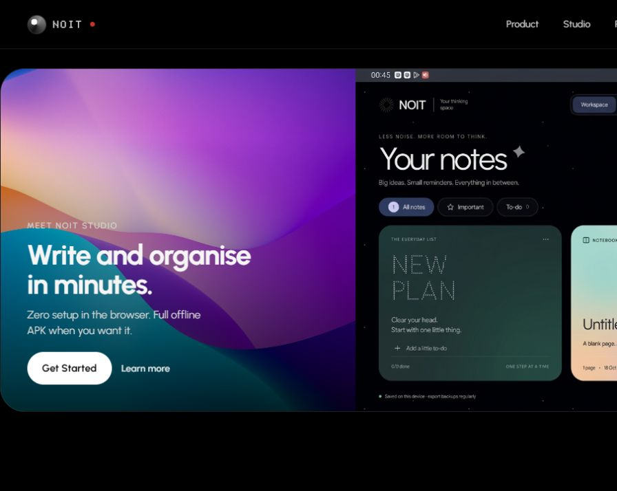
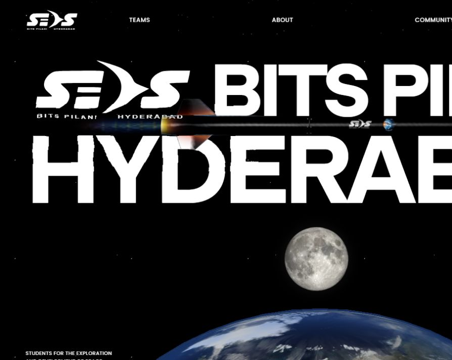
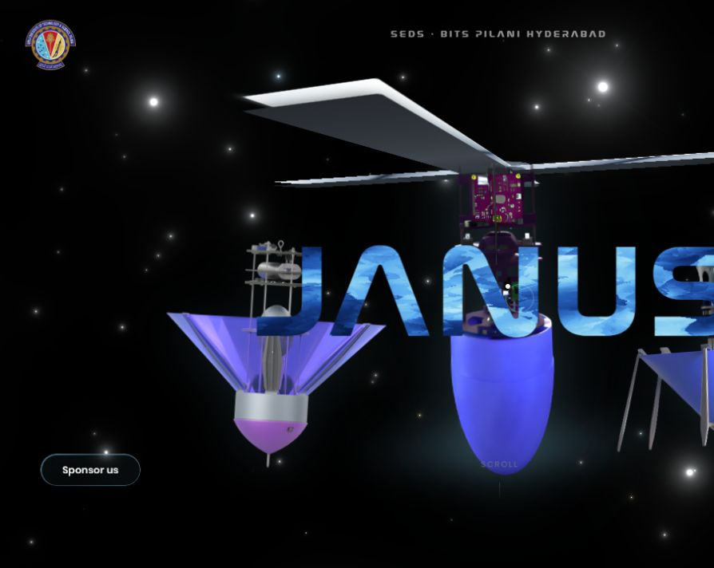

# Siddharth Pandey | Selected work

I build websites and the workflows behind them: customer journeys, ordering, inventory and staff tools. For project enquiries: [aekonira@gmail.com](mailto:aekonira@gmail.com).

## NOIT

[Open NOIT](https://noit.vercel.app)

A handwriting and PDF notebook PWA with editable ink, chapters, device-local notebooks and an optional passphrase vault. This is an independent test release. The image below shows the public website's product preview, rather than a screenshot of a customer's notebook.

## SEDS BITS Pilani Hyderabad

[Open the SEDS website](https://seds-bitsph.vercel.app)

A website project for the SEDS community at BITS Pilani Hyderabad, presenting its teams, projects and chapter activities. This screenshot shows the public website, separate from my inventory-management application work.

## Team Janus

[Open the Janus website](https://janus-seds.vercel.app)

A website project presenting the CanSat team's work, engineering, research and sponsorship information.

## Application work

- **Tuckr:** ordering-system work covering shops, menus, customer and vendor order flows, and administrative workflows. Demo available on request.
- **Inventory management:** application work for SEDS BITS Pilani Hyderabad, including operational inventory workflows.
- **Connected application systems:** work on separate customer and rider apps, staff/admin interfaces and shared backend workflows.
- **NOIT:** handwriting, PDFs, local storage, notebook organisation and an optional vault in a PWA.

I start with a defined workflow, agree on the first useful release, and plan milestones and handover around that scope.

Also contributed to [Maison Blanc](https://maisonblanc.in) alongside another developer.
